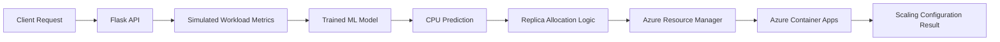

# Azure Predictive Autoscaler

**Machine learning–based CPU prediction and automated scaling configuration for Azure Container Apps.**

This project demonstrates how machine learning can be integrated with Microsoft Azure to predict future CPU utilization, recommend a replica count, and update an Azure Container App's scaling configuration through Azure Resource Manager.

The application is built with Python and Flask, packaged using Docker, and deployed to Azure Container Apps.

## Project Overview

Traditional autoscaling commonly responds to current resource utilization. This project explores a predictive approach in which a trained machine learning model estimates CPU utilization five minutes ahead and uses the prediction to calculate a replica recommendation.

The project implements the following workflow:

1. Generate workload metrics for the prediction pipeline.
2. Prepare input features and predict CPU utilization using a trained ML model.
3. Calculate a recommended replica count using a target CPU threshold.
4. Authenticate requests to the protected automatic scaling endpoint.
5. Update the Azure Container App's scaling configuration using Azure Resource Manager.
6. Return the prediction and scaling operation result through a REST API.

> **Current implementation:** The deployed prediction endpoint uses simulated workload metrics, not live Azure Monitor telemetry. The project demonstrates prediction-driven scaling configuration updates; continuous production autoscaling is not yet implemented.

## Architecture



### Main Components

| Component | Description |
|---|---|
| Flask API | Exposes health, prediction, workload, and scaling endpoints. |
| Machine learning model | Predicts CPU utilization five minutes ahead. |
| Prediction controller | Prepares features, generates predictions, and calculates replica recommendations. |
| Replica allocation logic | Uses a target CPU threshold of 60% and configured replica limits. |
| Azure Resource Manager | Authenticates and applies Container App scaling configuration updates. |
| Docker | Packages the application and its Python dependencies. |
| GitHub Actions | Automates deployment through the repository's workflow configuration. |

## Technology Stack

- **Language:** Python
- **API framework:** Flask
- **Machine learning:** scikit-learn, NumPy, pandas
- **Model persistence:** joblib
- **Cloud platform:** Microsoft Azure
- **Container platform:** Azure Container Apps
- **Resource management:** Azure Resource Manager REST API
- **Authentication:** Azure Identity and a protected scaling API token
- **Containerization:** Docker
- **CI/CD:** GitHub Actions
- **Visualization:** Streamlit and Plotly dependencies are included in the project.

## Repository Structure

```text
azure-ml-autoscaler/
├── .github/
│   └── workflows/              # Deployment workflow
├── models/
│   └── workload_model.joblib   # Trained ML model bundle
├── results/
│   └── predictions.csv         # Prediction/evaluation results
├── app.py                      # Application/dashboard entry point
├── server.py                   # Flask REST API
├── prediction_controller.py    # Prediction and scaling controller
├── resource_manager.py          # Replica allocation utility
├── train_model.py               # Model training and evaluation
├── Dockerfile                   # Container build configuration
├── requirements.txt             # Python dependencies
└── .gitignore
```

## How It Works

### 1. CPU prediction

The prediction controller loads the saved model from `models/workload_model.joblib` and prepares features such as:

- Current and historical CPU samples
- Recent average CPU utilization
- Simulated request activity
- Memory utilization
- Time of day

The model generates a CPU utilization prediction for five minutes ahead. The current demo generates simulated inputs, so repeated predictions may differ.

### 2. Replica recommendation

The controller uses a target CPU threshold of 60% to calculate the recommended replica count.

The simplified allocation rule is:

\[
R = \left\lceil \frac{\max(0, CPU_{\text{predicted}})}{60} \right\rceil
\]

The result is then constrained by the configured minimum and maximum replica limits.

For example:

| Predicted CPU | Recommended replicas |
|---:|---:|
| 20% | 1 |
| 45% | 1 |
| 70% | 2 |
| 95% | 2 |

These are illustrative outputs from the allocation rule, not guaranteed predictions from the deployed model.

### 3. Azure scaling configuration

The `/auto-scale` endpoint validates the scaling token before running the prediction and scaling workflow.

After authorization, the controller calculates the recommendation and calls the Azure resource management function. That function retrieves the Container App configuration and submits an update through Azure Resource Manager.

In the current implementation, the recommended value is applied to the Container App's **maximum replica setting**. This updates the scaling configuration; it does not directly set the number of currently running replicas.

## Deployed Demo

The application is deployed to Azure Container Apps.

**Base URL:**  
https://ml-autoscaler-demo.nicemushroom-0b729d0f.southindia.azurecontainerapps.io

### Available API Endpoints

| Method | Endpoint | Purpose |
|---|---|---|
| GET | `/` | Returns project status and available endpoints. |
| GET | `/health` | Checks application health. |
| GET | `/work` | Simulates computation and returns execution latency. |
| GET | `/predict` | Returns a CPU prediction and replica recommendation. |
| POST | `/scale` | Updates the scaling configuration to a supplied maximum replica count. |
| POST | `/auto-scale` | Predicts CPU utilization and applies the resulting scaling configuration. |

### Test the deployed API

Check application health:

```bash
curl -sS \
  https://ml-autoscaler-demo.nicemushroom-0b729d0f.southindia.azurecontainerapps.io/health
```

Expected response:

```json
{
  "status": "healthy"
}
```

Generate a prediction:

```bash
curl -sS \
  https://ml-autoscaler-demo.nicemushroom-0b729d0f.southindia.azurecontainerapps.io/predict
```

Example response:

```json
{
  "input_type": "SIMULATED_DEMO_METRICS",
  "predicted_cpu_5min_ahead": 44.66,
  "recommended_replicas": 1,
  "limits": {
    "min_replicas": 1,
    "max_replicas": 3
  }
}
```

Actual prediction values may differ between requests.

Test the workload endpoint:

```bash
curl -sS \
  "https://ml-autoscaler-demo.nicemushroom-0b729d0f.southindia.azurecontainerapps.io/work?iterations=10000"
```

The response includes the iteration count and observed execution latency.

### Test automatic scaling

The automatic scaling endpoint requires the `SCALING_API_TOKEN` value configured in the deployed Container App.

Set your existing token in the terminal without printing it:

```bash
read -s -p "Scaling token: " SCALING_API_TOKEN
echo
export SCALING_API_TOKEN
```

Then send the authenticated request:

```bash
curl -sS -X POST \
  "https://ml-autoscaler-demo.nicemushroom-0b729d0f.southindia.azurecontainerapps.io/auto-scale" \
  -H "Content-Type: application/json" \
  -H "X-Scaling-Token: $SCALING_API_TOKEN" \
  -d '{}'
```

A successful response contains the prediction, the scaling result, and a success status. The endpoint can return an error if authentication, Azure permissions, configuration, or the scaling operation fails.

**Security:** Never commit the scaling token, Azure credentials, or other secrets to the repository. Store deployment secrets securely and restrict access to the scaling endpoint.

## Run Locally

### Prerequisites

- Python 3.12 or a compatible Python version
- Git
- The trained model file in `models/workload_model.joblib`
- Azure credentials and appropriate permissions if you intend to test actual scaling operations

### 1. Clone the repository

```bash
git clone https://github.com/sastarogers/azure-ml-autoscaler.git
cd azure-ml-autoscaler
```

### 2. Create a virtual environment

```bash
python3 -m venv .venv
source .venv/bin/activate
```

On Windows, activate it using:

```powershell
.venv\Scripts\Activate.ps1
```

### 3. Install dependencies

```bash
python -m pip install --upgrade pip
pip install -r requirements.txt
```

### 4. Configure the prediction settings

The controller supports the following environment variables:

```bash
export MIN_REPLICAS=1
export MAX_REPLICAS=3
export TARGET_CPU=60
```

These variables control the minimum replica limit, maximum replica limit, and target CPU threshold used by the recommendation logic.

### 5. Start the API

```bash
python server.py
```

The Flask server listens on port `8000` by default.

In another terminal, test it:

```bash
curl http://127.0.0.1:8000/health
```

```bash
curl http://127.0.0.1:8000/predict
```

Local prediction requests use simulated metrics.

### 6. Configure Azure scaling access

To test the scaling endpoints, configure the following environment variables with values for your Azure deployment:

| Variable | Purpose |
|---|---|
| `SCALING_API_TOKEN` | Token required by the protected scaling endpoints. |
| `AZURE_SUBSCRIPTION_ID` | Azure subscription containing the Container App. |
| `AZURE_RESOURCE_GROUP` | Resource group containing the Container App. |
| `AZURE_CONTAINER_APP_NAME` | Name of the Container App to update. |
| `MIN_REPLICAS` | Minimum replica limit. |
| `MAX_REPLICAS` | Maximum permitted replica recommendation. |
| `TARGET_CPU` | Target CPU threshold used for replica recommendations. |

The Azure Identity library uses `DefaultAzureCredential` to obtain an Azure Resource Manager access token. Configure an appropriate supported identity, such as Azure CLI authentication during local development or a managed identity in Azure, and grant it the necessary permissions.

For example, local development can use:

```bash
az login
```

The scaling API token and Azure Resource Manager credentials serve different purposes: the API token authorizes the incoming HTTP request, while the Azure identity authorizes the resource update.

**Important:** Do not expose a production scaling token or grant broader Azure permissions than required.

## Train the Model

The repository includes `train_model.py` for the model training and evaluation workflow.

Run it from the repository root:

```bash
python train_model.py
```

Review the script's input data paths and output paths before retraining. Retraining may replace the existing model artifact or evaluation results, depending on the implementation.

The deployed prediction controller expects the saved model bundle at:

```text
models/workload_model.joblib
```

## Model Evaluation

The recorded evaluation results for this project are:

| Metric | Result |
|---|---:|
| Prediction records evaluated | 2,014 |
| Mean absolute error (MAE) | 3.428 percentage points |
| Root mean squared error (RMSE) | 4.371 percentage points |
| Mean actual CPU utilization | 29.12% |
| Mean predicted CPU utilization | 29.25% |

MAE measures the average absolute prediction error. RMSE gives greater weight to larger errors.

These results describe the model evaluation dataset. They do not independently demonstrate production scaling performance or prove energy savings, cost reductions, or improved application availability.

## Deployment

The repository includes a GitHub Actions workflow under `.github/workflows/` for deployment.

The application is packaged using the repository's Dockerfile, which installs the Python dependencies, copies the application code and model artifact, and starts the Flask server.

For a deployment to succeed, the workflow and Azure environment must be configured with the required registry access, deployment credentials or identity, Container App settings, and application environment variables.

Consult the workflow file for the exact secrets, variables, and deployment steps used by this repository.

## Limitations and Future Improvements

The current implementation is a proof of concept with the following limitations:

- **Simulated metrics:** Predictions use simulated workload inputs rather than live Azure Monitor telemetry.
- **Scaling configuration updates:** The automatic endpoint applies a recommended maximum replica setting. It does not continuously monitor workloads or independently maintain a live prediction-driven scaling loop.
- **Evaluation scope:** Model accuracy is evaluated separately from end-to-end production scaling performance.
- **Operational validation:** Further testing is needed to measure behavior under real workloads, scaling delays, failures, and changing traffic patterns.

Potential future improvements include:

- Integrating live CPU and memory metrics from Azure Monitor.
- Scheduling recurring predictions and scaling decisions.
- Comparing predictive scaling with reactive autoscaling.
- Testing under controlled workload patterns and measuring scaling response time.
- Evaluating resource utilization, cost, and energy consumption with appropriate baselines.
- Adding automated tests, monitoring, and more detailed deployment observability.

## Project Outcome

This project demonstrates an end-to-end integration of a trained machine learning model, a Flask API, Docker, and Azure Resource Manager.

The implementation connects CPU prediction and replica recommendation to a protected Azure scaling configuration update, providing a foundation for further work on telemetry-driven predictive autoscaling.

## Author 

Atharva Ranjan, Dhiti Wadhwa and Gauri Bhonsle


